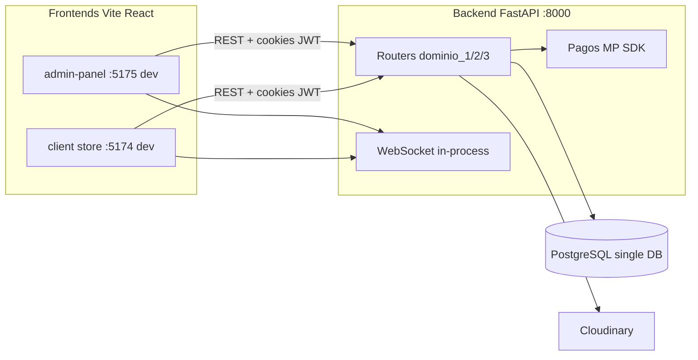

# Fase 0 — Auditoría Food Store (solo lectura)

**Fecha:** 2026-10-21  
**Ramas auditadas:** `feat/nuevas-mejoras` (creada desde `main` en los tres repos)  
**Repos:**

| Rol | Carpeta local | Remoto |
|-----|---------------|--------|
| Backend | `Food-store-admin/BACKEND` | `food-store-admin` |
| Admin | `food-store-admin-panel` | `food-store-admin-panel` |
| Cliente | `Food-Store-client/store` | `food-store-client` |

**Referencia de producto objetivo:** `docs/nuevo-sistema.md` (Partes A, B, C).

---

## 1. Mapa de arquitectura actual

### 1.1 Vista general

- **Monolito single-tenant:** una sola base (`db-parcial-1` en `.env`), sin tabla `tenants`, sin middleware de slug.
- **Capas backend:** `BaseRepository` → `UnitOfWork` → `Services` → `Routers` (patrón respetado en dominios).
- **Estadísticas:** `EstadisticasRepository` no hereda `BaseRepository` (clase standalone con SQL agregado) — `app/modules/estadisticas/repository.py`.
- **Arranque:** `app/main.py` llama `create_all_tables()` en el `lifespan` además de existir Alembic (2 revisiones en `app/db/migrations/versions/`).
- **Frontends separados:** el antiguo `Food-store-admin/FRONTEND/` ya no existe; el admin vive en `food-store-admin-panel`.

### 1.2 Módulos backend (montaje en `app/main.py`)

| Prefijo | Dominio | Archivo router |
|---------|---------|----------------|
| `/api/v1/auth` | Auth + refresh | `dominio_1/auth/routers.py` |
| `/api/v1/usuarios` | Usuarios y roles | `dominio_1/usuarios/routers.py` |
| `/api/v1/direcciones` | Direcciones cliente | `dominio_1/direcciones/routers.py` |
| `/api/v1/categorias`, `productos`, `ingredientes`, `unidades-medida` | Catálogo | `dominio_2/*` |
| `/api/v1/pedidos` (+ WS) | Pedidos | `dominio_3/pedidos/routers.py` |
| `/api/v1/pagos` | Mercado Pago + webhook | `dominio_3/pagos/routers.py` |
| `/api/v1/estadisticas` | KPIs (solo ADMIN) | `estadisticas/router.py` |
| `/api/v1/uploads` | Cloudinary | `uploads/routers.py` |

### 1.3 Flujo de un pedido online (punta a punta)

1. **Catálogo:** `Food-Store-client/store` → `features/catalogo/*` → `GET /api/v1/productos`, categorías (lectura pública o autenticada según endpoint).
2. **Carrito:** `store/carritoStore.ts` (Zustand) → drawer `CartDrawer.tsx` → ruta `/realizar-pedido`.
3. **Checkout:** `RealizarPedidoPage.tsx` → direcciones vía `pedidosApi` → `POST /api/v1/pedidos/` → `PedidoService.crear` (`pedidos/services.py`): valida stock, forma de pago, snapshots de precio, historial inicial, estado `PENDIENTE`, evento WS.
4. **Pago MP:** `POST /api/v1/pagos/crear` → `PagoService.crear_pago` → Brick en `MercadoPagoBrick.tsx` → consulta `GET /api/v1/pagos/{pedido_id}` / modal `PagoResultadoModal.tsx`.
5. **Webhook:** `POST /api/v1/pagos/webhook` → firma HMAC (si hay `data.id`) → `PagoService.procesar_webhook` → si `approved`, `PENDIENTE` → `CONFIRMADO` (`pagos/services.py`).
6. **Efectivo / transferencia:** pedido queda `PENDIENTE` hasta confirmación manual por staff (`PATCH /api/v1/pedidos/{id}/estado`).
7. **Cocina / kanban:** `food-store-admin-panel` → `PedidosKanbanPage.tsx`, `CocinaPage.tsx` → `PATCH .../estado` con FSM en `PedidoService.avanzar_estado`.
8. **Cliente sigue pedido:** `PedidosPage.tsx`, `OrderTimeline.tsx`, `useOrderStatusWS.ts` → WS `/api/v1/pedidos/ws/pedidos` (suscripción por pedido vía mensaje `subscribe-order`).

### 1.4 Máquina de estados actual (5 estados académicos)

Definida en `pedidos/services.py` (`TRANSICIONES`, `TRANSICIONES_POR_ROL`):

| Estado | Siguientes (staff) | Cliente puede cancelar |
|--------|-------------------|-------------------------|
| PENDIENTE | CONFIRMADO, CANCELADO | sí |
| CONFIRMADO | EN_PREP, CANCELADO | sí |
| EN_PREP | ENTREGADO, CANCELADO | no |
| ENTREGADO | — | — |
| CANCELADO | — | — |

**Gap vs. `nuevo-sistema.md` B3:** no existen `preparado`, `enviado`, tipos envío/retiro/mostrador ni historial con usuario en todas las transiciones de forma alineada al modelo objetivo (sí hay tabla `historial_estado_pedido`, pero FSM es más simple).

---

## 2. Matriz de requerimientos (Partes A, B, C)

Leyenda: ✅ completo · ⚠️ parcial · ❌ falta

### Parte A — Infraestructura (Contabo / Docker / ops)

| ID | Requerimiento | Estado | Evidencia |
|----|---------------|--------|-----------|
| A1 | Topología Compose (Caddy, API, Postgres, Redis, Kuma, backup) | ❌ | Solo `BACKEND/docker-compose.yml` con db+backend+builds a `FRONTEND` inexistente y store; sin Caddy, Redis, Kuma |
| A2 | Hardening VM (UFW, fail2ban, SSH llave, etc.) | ❌ | No hay scripts ni docs en repo |
| A3 | Caddy TLS, wildcard, rate limit proxy | ❌ | No `Caddyfile` |
| A4 | Postgres control + `tenant_{slug}`, roles por DB | ❌ | Una sola DB en `app/core/config.py` |
| A5 | Redis pub/sub interno | ❌ | Sin Redis en código ni compose productivo |
| A6 | Backups cifrados off-site + restore test | ❌ | No scripts `backup`/`restore` |
| A7 | CI/CD GH Actions + rollback | ❌ | Sin `.github/workflows/` en el monorepo |
| A8 | Observabilidad (JSON logs, request-id, Kuma) | ⚠️ | Logging HTTP en `main.py`; sin request-id ni slug |
| A9 | Entregables infra (`runbook`, `checklist-hardening`) | ❌ | No existen (salvo este doc y `nuevo-sistema.md`) |

### Parte B — Aplicación

| ID | Requerimiento | Estado | Evidencia |
|----|---------------|--------|-----------|
| B1 | Backend compartido + resolución tenant + DB control | ❌ | Sin middleware tenant; sesión única `get_session()` |
| B1 | API pública landings (catálogo, tracking token) | ⚠️ | Catálogo parcialmente público; tracking por token público no encontrado |
| B1 | Roles dueño/cocina/cajero + admin plataforma | ⚠️ | Roles `ADMIN`, `PEDIDOS`, `STOCK`, `CLIENT` en seed (`db/seed.py`); no mapeo 1:1 a dueño/cocina/cajero |
| B2 | Tests aislamiento local A vs B | ❌ | No hay multi-tenant que testear |
| B3 | FSM envío/retiro/mostrador + historial completo | ⚠️ | FSM 5 estados + `historial_estado_pedido`; sin envío/retiro/mostrador |
| B4 | MP OAuth por local + webhook `/webhooks/mp/{slug}` | ⚠️ | Token global `MP_ACCESS_TOKEN` en config; webhook único `/api/v1/pagos/webhook`; idempotencia `pay_{pedido_id}` en `pagos/models.py` + tests |
| B5 | Tiempo real SSE/WS + Redis multi-worker | ⚠️ | WS en `ws_manager.py` + `ws_handler.py`; in-memory, un proceso; sin Redis |
| B6 | KDS + seguimiento público con token | ⚠️ | `CocinaPage.tsx`, kanban; cliente usa login + WS, no página pública por token |
| B7 | Métricas producto (ahorro vs delivery, etc.) | ⚠️ | API `estadisticas/*` + Recharts en `DashboardPage`; sin “ahorro vs apps” |
| B7 | Extras P1 (horarios, zonas, cupones, …) | ❌ / ⚠️ | Direcciones sí; sin zonas de envío, horarios auto, cupones |
| B8 | Alembic como fuente de verdad + auditoría | ⚠️ | 2 migraciones; `create_all` en cada arranque (`main.py`) |
| B9 | Landings estáticas por tema | ❌ | Cliente React full app, no plantilla estática desacoplada |
| B10 | `docs/onboarding-local.md`, `api.md` | ❌ | READMEs por repo; sin esos docs |

### Parte C — Caja y facturación (diseño P2)

| ID | Requerimiento | Estado | Evidencia |
|----|---------------|--------|-----------|
| C1 | Pedido mostrador, caja, arqueo, rol cajero | ❌ | `CajeroPedidosPage` lista/filtra; sin caja ni turnos |
| C2 | Facturación ARCA / WSAA / CAE | ❌ | No hay módulo ni adaptador `Facturador` |

---

## 3. Bugs, código muerto e inconsistencias

### 3.1 Seguridad / comportamiento

| Severidad | Hallazgo | Evidencia |
|-----------|----------|-----------|
| **Alta** | **IDOR en historial:** `GET /api/v1/pedidos/{id}/historial` no valida `usuario_id` ni ownership; cualquier `CLIENT` autenticado con otro `pedido_id` puede leer historial | `pedidos/routers.py` líneas 140–151 vs `obtener()` que sí filtra |
| **Media** | **WS filtra poco para CLIENT:** `broadcast_pedido` envía a sala `role:CLIENT` para todos los estados (`ROLES_POR_ESTADO` en `pedidos/services.py`) — posible filtración de eventos entre clientes conectados |
| **Media** | **Webhook MP:** verificación HMAC condicionada a presencia de `payload.data.id` (`pagos/routers.py`); sin id, no valida firma |
| **Baja** | Cliente `App.tsx` puede pasar `pedidoIds: []` a `useOrderStatusWS` — seguimiento en vivo depende de implementación de subscribe manual |

### 3.2 Deuda / docs / repos

- **README backend** aún describe `FRONTEND/` y puerto admin 5173 — `Food-store-admin/README.md`, `BACKEND/README.md`.
- **`docker-compose.yml`** referencia `../FRONTEND` (eliminado del repo backend).
- **`docs/nuevo-sistema.md`** menciona Chart.js; el admin usa **Recharts** (`food-store-admin-panel/package.json`, `features/estadisticas/components/*`).
- **Doble página de estadísticas en admin:** `DashboardPage` (API real) vs `pedidos/pages/EstadisticasPage.tsx` (agrega desde listado de pedidos).
- **Rutas cocina/cajero/estadísticas** existen en `App.tsx` pero **no están en el sidebar** (`AdminLayout.tsx`).
- **Roles nominales:** documento objetivo habla de `dueño`; código usa `ADMIN` + `PEDIDOS` + `STOCK`.
- **Dependencias backend:** `requirements.txt` lista `psycopg2-binary` pero SQLAlchemy 2.x con URL `postgresql://` intenta cargar **`psycopg` (v3)**; en entorno limpio falla hasta instalar `psycopg` y `python-multipart` (no listado en requirements). Detectado al levantar API local 2026-10-21.

### 3.3 Inconsistencias front ↔ back

| Tema | Detalle |
|------|---------|
| Auth | Axios envía `Authorization: Bearer`; API valida principalmente **cookie** `access_token` (`core/deps.py`) |
| Tipos | `DetallePedidoRead` sin `id` en backend; admin types con `id?` opcional |
| WS admin | Backend expone `/ws/admin/pedidos`; panel usa `/ws/pedidos` vía `useAdminOrdersFeed.ts` (funcional si roles coinciden) |
| CORS | `.env.example` puertos 5173/5174; dev actual admin en **5175** (config local, no commiteada) |

---

## 4. Riesgos de seguridad (resumen)

| Área | Estado actual | Riesgo |
|------|---------------|--------|
| Auth JWT + refresh | Implementado en `dominio_1/auth` | Bajo si cookies `Secure` en prod (`SECURE_COOKIES` en config) |
| Rate limit login/register | SlowAPI en auth (`core/rate_limit.py`, tests `test_auth.py`) | Bajo en endpoints cubiertos |
| IDOR pedidos | `obtener`, `consultar_pago`, cancel cliente con check | Bajo salvo **historial** |
| IDOR multi-tenant | N/A (single DB) | Crítico **a futuro** si se comparte DB por error |
| CORS | Lista explícita en `settings.cors_origins` | Medio si se despliega con `*` accidental |
| Secretos | `.env` local con MP/Cloudinary (no commitear) | Alto si se sube `.env` |
| Uploads | Rol ADMIN en `uploads/routers.py` | Bajo |
| SQL injection | SQLModel/ORM predominante; estadísticas usan `text()` controlado | Bajo con revisión en nuevas queries |
| Webhook MP | HMAC + estados terminales | Medio (bypass sin `data.id`) |

No se encontró carpeta `.cursor/rules/*.mdc` en este workspace (el prompt maestro las menciona; pueden vivir solo en otra máquina o faltar en el clone).

---

## 5. Tests existentes y huecos

**Ubicación:** `Food-store-admin/BACKEND/tests/`

| Archivo | Cubre |
|---------|--------|
| `test_auth.py` | Registro, login, refresh, `/me`, rate limit |
| `test_usuarios.py` | CRUD, roles |
| `test_direcciones.py` | CRUD direcciones |
| `test_pedidos.py` | Crear, FSM, listados cliente vs admin |
| `test_pagos.py` | Crear pago mock, idempotencia, webhook → CONFIRMADO, 403 ajeno |
| `test_estadisticas.py` | Endpoints KPI |
| `test_uploads.py` | Upload Cloudinary mock |
| `test_websocket.py` | Auth WS, subscribe, pedido ajeno → error |

**Imprescindible agregar antes de producción multi-local:**

- IDOR: `GET /pedidos/{id}`, `GET /historial` con usuario B.
- Aislamiento tenant (cuando exista middleware).
- Webhook: firma inválida, replay notification id.
- FSM: transiciones ilegales por rol.
- Migraciones: test que arranque solo con Alembic (sin `create_all`).

**Frontends:** no hay tests automatizados (ni Vitest/Playwright) en admin ni client.

---

## 6. Qué bloquea producción hoy

1. **Modelo single-tenant** — una DB, un MP token global, sin onboarding de locales.
2. **Infra inexistente** en repo — sin Compose productivo, Caddy, backups, CI/CD, Redis.
3. **`create_all` en producción** — riesgo de esquema divergente vs Alembic.
4. **IDOR historial** y posible **fuga WS a rol CLIENT**.
5. **Docker Desktop apagado** en dev Windows; compose actual **roto** (FRONTEND missing).
6. **Dependencias backend incompletas** en `requirements.txt` para venv fresco (`psycopg`, `python-multipart`).
7. **Sin runbooks** ni procedimiento de restore probado.
8. **Landings** acopladas al SPA cliente, no estáticas con fallback WhatsApp.

---

## 7. Cambios necesarios para “una DB por local + backend compartido”

| Componente | Hoy | Objetivo (según `nuevo-sistema.md`) |
|------------|-----|-------------------------------------|
| Config DB | `Settings.DATABASE_URL` fija | DB `control` + `tenant_{slug}`; credenciales por tenant |
| Sesión SQLAlchemy | `get_session()` global | Dependency `get_tenant_session(slug)` tras middleware |
| Middleware | No existe | Resolver slug (host/header) → tenant en `control.tenants` |
| Engines | Un `engine` | Pool/cache de engines con tope por slug |
| Migraciones | 2 revisiones, una DB | `alembic` por tenant + script `migrar_todos` |
| MP | Env global | OAuth + tokens cifrados **por DB local** |
| Webhook | `/api/v1/pagos/webhook` | `/webhooks/mp/{slug}` + validación por tenant |
| WS | `WSManager` en memoria | Redis pub/sub canal `tenant:{slug}` |
| Auth plataforma | Solo roles negocio | Rol separado admin plataforma + rutas |
| Tests | Single DB | Fixture multi-DB o schemas aislados + test A≠B |
| Frontends | Una `VITE_API_URL` | Base URL por dominio del local; landings estáticas |

**Riesgos de migración del esquema actual:**

- Renombrado de módulos ya hecho (`categorias`, `productos` en minúscula) — ok en single tenant.
- Pasar a multi-DB requiere **congelar** `create_all`, baseline Alembic por tenant, script de **provision** (crear rol PG, DB, migrate, seed dueño).
- Datos demo en `seed.py` / `poblar_catalogo.py` deben ejecutarse **por local**, no una vez global.

---

## 8. Entorno local levantado (2026-10-21)

| Proceso | URL | Notas |
|---------|-----|--------|
| API | http://127.0.0.1:8000 | Swagger `/docs`; CORS ampliado por variable de entorno de sesión (5174/5175) |
| Admin | http://localhost:5175 | **No usa 5173** (pedido tuyo) |
| Cliente | http://localhost:5174 | Según `vite.config.ts` |
| PostgreSQL | `localhost:5432` | Docker Compose **no** corriendo; Postgres local activo |
| Docker | — | Daemon no disponible en la máquina al auditar |

---

## 9. Decisiones que necesito de vos (con recomendación)

| # | Decisión | Recomendación |
|---|----------|----------------|
| 1 | ¿Aprobás esta auditoría para pasar a **Fase 1 (plan SDD)**? | Sí, con prioridad M1 (núcleo + seguridad IDOR) antes de M3 multi-DB |
| 2 | ¿M0 infra en paralelo o después del fix de IDOR/webhook? | Paralelo solo documentación/scripts; deploy real después de M1 tests |
| 3 | ¿Renombrar roles a dueño/cocina/cajero o mapear en UI? | Mapeo en UI/docs; evitar migración de roles en DB hasta M3 |
| 4 | ¿`client` repo como base de landing temática o repo nuevo? | Evolucionar `Food-Store-client/store` a plantilla + `theme.json` por local |
| 5 | ¿Corregir `requirements.txt` (psycopg3 + multipart) en la primera tarea de Fase 2? | Sí, bloquea onboarding de devs |

---

## 10. Resumen ejecutivo (≤ 5 líneas)

Food Store hoy es un **stack académico single-tenant** sólido en capas (pedidos, MP, WS, estadísticas, tests backend), con **front admin y client separados**. Falta **casi toda la Parte A**, **multi-tenant**, **landings estáticas** y **Parte C**. Bloqueadores inmediatos: **IDOR historial**, **WS/escala**, **`create_all` vs Alembic**, **compose/docs rotos** y **deps de arranque**. Listo para Fase 1 si aprobás este documento.

---

*Fin Fase 0 — sin modificaciones al código del producto (solo creación de este archivo).*
